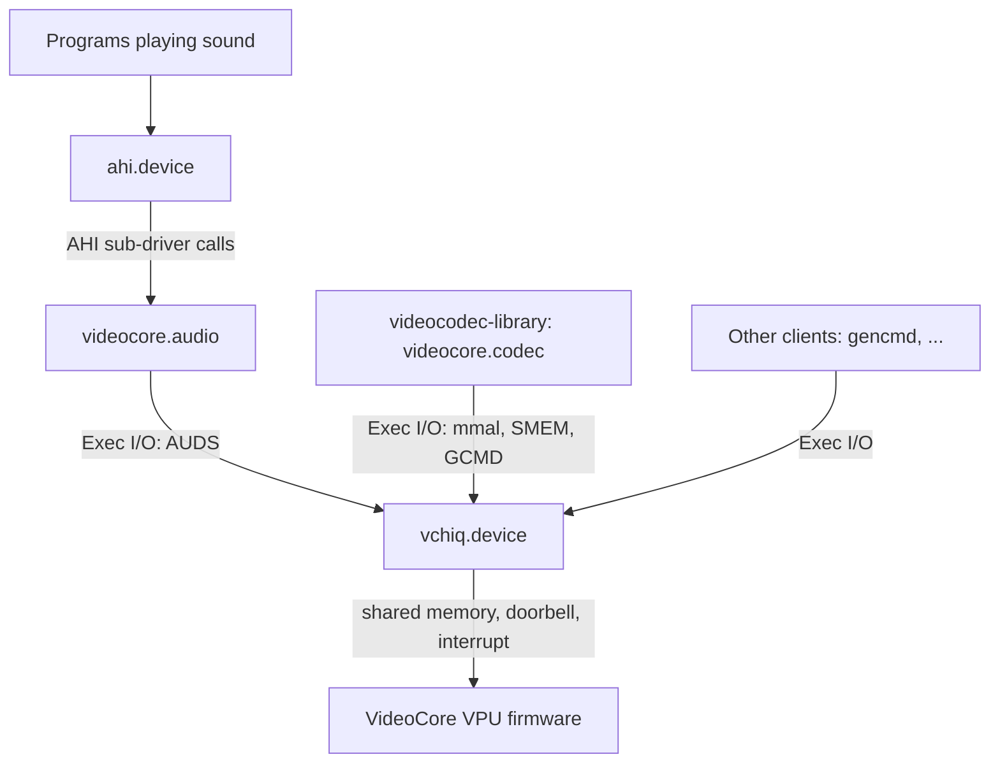
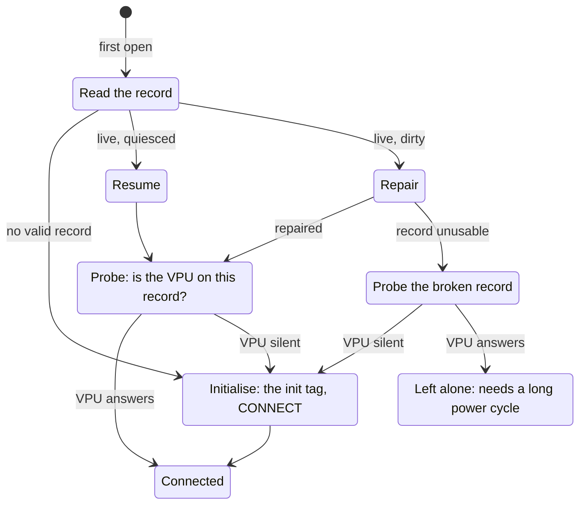
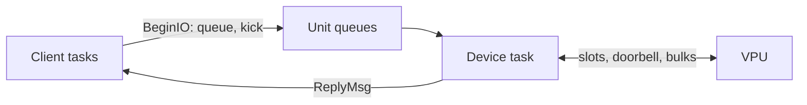
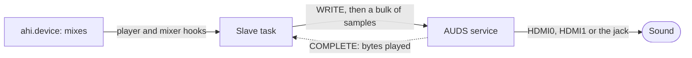

# emu68-vchiq-driver: architecture

How AmigaOS on a PiStorm reaches the Raspberry Pi's VideoCore firmware, and
plays sound through it: why the component is built the way it is, and the
firmware behaviour the design rests on. This document stays at the level of
components, tasks, ownership and data paths; the source files carry the rest.
The device's interface is in [developer-guide.md](../developer-guide.md), the
firmware's measured behaviour in [firmware-facts.md](firmware-facts.md). The
video libraries on top of `vchiq.device` are videocodec-library's, with their
own architecture document.

---

## 1. The layers

| Binary | Installed in | What it is |
|---|---|---|
| `vchiq.device` | `DEVS:` | The VCHIQ transport: the shared window, the doorbell, the interrupt and the connection's life across Amiga resets. Each opened unit is one service. |
| `videocore.audio` | `DEVS:AHI/` | An AHI sub-driver that plays what ahi.device mixes to HDMI0, HDMI1 or the headphone jack (section 5). |
| `VCHIQInfo` | `C:` | The user's check of the link: Emu68's resources, the device, the firmware. |

Every client sees only the device's public header, `devices/vchiq.h`, which
includes nothing but Exec headers. The video libraries' backend,
`videocore.codec`, is one such client: the device knows nothing of it.

---

## 2. What the Raspberry Pi 4 offers

* **The VideoCore VI VPU and its firmware.** It boots the ARM, keeps running
  under Emu68, and serves its functions as VCHIQ (VideoCore Host Interface
  Queue) services, over a shared-memory message transport, as Linux's
  `vchiq` driver reaches them: `GCMD` (gencmd, the firmware's command line),
  `AUDS` (sound to HDMI0, HDMI1 or the headphone jack), and `mmal` and `SMEM`
  (the codecs, the ISP and memory import, which the video libraries use).
* **No access to Amiga Chip RAM**: neither the VPU nor PiStorm DMA reaches it.
  Buffers the VPU reads or writes are in Fast RAM.

---

## 3. VCHIQ under Emu68

A VCHIQ client needs four things:

| Need | Here |
|---|---|
| Doorbell | found through the device tree (the `vchiq` label), mapped by Emu68 |
| Interrupt | `gic400.library`; a polled tick where there is no interrupt driver (Pi 3) |
| One firmware call, with the slot area's bus address | `mailbox.resource` |
| Coherent memory: 336 KiB, below 1 GiB, persistent across Amiga resets | a block of `cma.resource`'s uncached zone (3.1) |

These facts shape everything else:

* **The slot area must be non-cacheable, not merely cache-maintained.** The two
  shared-state blocks interleave words written by each side inside one cache
  line, and the receiver rewrites a word inside the sender's slot to claim it.
  A write-back of a stale line would destroy the VPU's writes.
* **The VPU sees the lowest 1 GiB only, through the `0xC0000000` alias**
  (`/soc` `dma-ranges`). The slot area and page lists live there.
* **Bulk payloads are not bound by that on the BCM2711.** Its firmware uses
  36-bit page lists and a DMA engine that sees all memory, so sound, pictures
  and streams can live in ordinary Fast RAM (identity mapped under Emu68: 68k
  address = ARM physical). They stay cacheable, cleaned before a
  transmit and invalidated after a receive. Partial cache lines at the ends of
  a receive go through the VPU's fragment pool, so any alignment works.
* **Everything in shared memory is little-endian**, and the services'
  structures are packed by hand: m68k gcc aligns 64-bit fields to 2 bytes, ARM
  to 8.
* **The VPU is the master.** The host lays out its half of slot zero, sends the
  mailbox tag, waits for the VPU's half, exchanges CONNECT, then opens services
  by fourcc.

### 3.1 The shared window

Emu68 maps Fast RAM write-back and the VideoCore windows (`vc4-mem` for the RTG
driver, the firmware's `gpu_mem`) write-through, and no 68k-side mechanism
changes that. On the Cortex-A72 and A53 write-through is non-cacheable in
effect, which is why the RTG framebuffer needs no cache flushes and bulk buffers
inside `vc4-mem` skip cache maintenance.

The slot area is a block of Emu68's general uncached zone: the `cma` overlay
(4 MiB by default, made in whole 2 MiB; the window's 336 KiB fit the
smallest, `size=2`) carves it out below 1 GiB, maps it non-cacheable and keeps
it out of AmigaOS's memory lists, and `cma.resource` in the Emu68 ROM hands it
out. The device takes its window at its first open and gives it back at
expunge.

Persistence rests on two properties of that allocator as it is today: the
first page-aligned block of a fresh zone is always its base + 4096, whatever
the size, and the allocator never writes into a block, only its own headers at
the zone's ends, rebuilt at every 68k reset. So while vchiq is the first client
after a reset, it gets the same window back with the last session's record in
it. A client that takes memory first moves the window while the VPU still
writes the old one. Nothing clears the zone at Emu68's boot either, which is
what 3.2 has to deal with.

### 3.2 Surviving an Amiga reset

A reset by the 68k (`ColdReboot()`, a Guru, `C:Reboot`) restarts the 68k while
the Pi, and so the VPU and its VCHIQ state, keep running. A hardware reset can
reboot the whole Pi, depending on the PiStorm firmware. Such a reboot keeps
DRAM, and the record in it.

The VPU does not support a host that re-initialises VCHIQ behind its back: it
refuses a second init tag. So the connection is persistent. The slot area sits
at a fixed address in the window, the init tag goes out once per VPU boot, and
the window keeps a record of the session. At its first open the device reads
that record:

* **Resume** follows a session that closed every service and released every
  message: it rebuilds the host's private counters from the shared positions.
* **Repair** follows one that died without quiescing: it uses the open ports
  and unreturned slots the record keeps to drain the VPU's stream and close
  what was left.
* **The probe** exists because DRAM can outlive the VPU, so a record is trusted
  only once the VPU has answered on it. The device opens a service nobody
  serves. A live VPU refuses it within a millisecond; a VPU that restarted does
  not read this ring and stays silent for 500 ms. Silence means a stale record:
  it is forgotten, the window initialised afresh in place, and the fresh VPU
  takes the tag. Only a timeout does this, so a live but unrecoverable session
  is never overwritten. The accepted risk is a false timeout on a live VPU,
  which destroys its slot zero; a Pi power cycle recovers.

A **reset guard** (`emu68-common`: a keyboard reset handler plus a
`ColdReboot()` trampoline) quiesces the connection on both reset paths, which
also stops the VPU from writing a frame into memory the next OS instance has
reused. It runs with interrupts off, so it busy-polls and neither waits nor
locks. `Avail FLUSH` expunges the device, which quiesces too.

Closing a service does not stop what its client set running on the VPU, so a
client that runs things there installs a guard of its own while its service is
open. Installed after the device's guard, it runs first, while the link still
works: the video libraries' `videocore.codec` stops its components in it (its
own architecture document says how).

A keyboard reset can arrive in an interrupt, where no guard can run, but it
restarts the Pi and the VPU with it. A Guru runs no guard: the next first open
finds the record dirty and repairs it.

`tests/test_resets.py` covers all of this except repair after a real crash.

---

## 4. vchiq.device

A new-style Exec device. Each `OpenDevice()` opens one VCHIQ service, named by
fourcc in the request; up to 16 services and any number of openers work at
once, and a task shares a service by copying its opened request. Messages are
`CMD_READ` and `CMD_WRITE`, bulk transfers two commands of their own, and every
reply is an Exec message to the client's port.

* **One task does all the work.** `BeginIO` only queues the request and kicks
  the task. Each round the task walks the VPU's stream, copies held messages
  into waiting reads, and issues each unit's queued requests until the VPU has
  no room; a recycled slot or a finished bulk brings it back with a doorbell.
  No client code ever runs in that task, and nothing a client does can deadlock
  it.
* **Order is kept per service and direction.** Writes and bulk transmits share
  one queue, so a message and the bulk that belongs to it are never separated;
  MMAL depends on it. Bulk receives have a queue of their own: VCHIQ allows four
  bulks in flight per service and direction, and with one queue a transmit
  waiting for room would hold up a receive the VPU may need finished before it
  takes that transmit. (A precaution: no such stall has been seen.)
* **Back-pressure, not loss.** A service holds up to 128 received messages.
  When that is full the walk stops until the client reads, as Linux's user
  interface does.
* **Opens and closes wait for the VPU** with the ring's lock released. A close
  never gives up while the VPU makes progress: a service left open would call
  back into a freed unit.
* **SoC differences** live in one structure, filled once from the device tree.
  The BCM2711 uses 36-bit page lists and the GIC doorbell interrupt. The
  BCM2836/7 (Pi 3, CM3, Zero 2 W) uses 32-bit bus addresses through the alias
  and, with no interrupt-controller driver in the stack, a 2 ms polling tick.

---

## 5. videocore.audio

An AHI sub-driver on `vchiq.device` alone. AHI mixes, the 68k does only the byte
swap, and the firmware's count of what it played is the clock.

* **One slave task per `AHI_AllocAudio()`**, with its own `AUDS` service, so
  streams share nothing.
* **The slave owns every request and buffer.** Start and Stop set a command and
  wait until the slave has carried it out. Stop returns only once every chunk is
  home, so no hook runs and nothing is freed while the VPU can still read it.
* **Calls from interrupts only store and signal.** `AHIsub_Update()` does nothing,
  since the slave rereads the hooks every pass. `AHIsub_HardwareControl()` stores
  the volume or the output for the slave to send.
* **A failed service** (a request's error, or no COMPLETE for a second with
  samples queued) makes the stream dead: the timer paces the hooks, the samples
  are dropped, programs never hang. A request that never comes back leaves the
  stream allocated.

---

## 6. Firmware facts and limits

The firmware refuses almost nothing, so its limits become rules of the design.
The measurements behind each row and the sources are in
[firmware-facts.md](firmware-facts.md); `AGENTS.md` lists what must never be done.
The limits of the codecs are videocodec-library's.

| The firmware | So the design |
|---|---|
| Answers a second init tag with `0xFFFFFFFF` | One init per VPU boot, a persistent connection (3.2) |
| Lets a closed service's work on the VPU run on | A client stops its own work in a reset guard that runs before the device's (3.2) |
| Answers only CONTROL, CONFIG and CLOSE on `AUDS`, and counts what it played in COMPLETE | videocore.audio waits for a RESULT after those three only; COMPLETE is its clock (5) |
| Plays with a gap when one chunk of sound is in flight | Eight chunks of 10 ms, several in flight |
| Takes no channel order in CONFIG | A 7.1 frame goes in HDMI's order |

---

## 7. Design decisions

| Decision | Why |
|---|---|
| A transport in 68k code, not an ARM-side implementation in Emu68 | keeps the stack's "68k drivers over MMIO" architecture; Emu68's footprint is its own `cma` overlay, nothing of ours |
| `vchiq.device`, one unit per service | many clients at once, Exec I/O semantics, no client code in the device's task |
| A persistent connection, one init per Pi power cycle | the VPU does not support re-initialisation; every Amiga reset is survivable |
| The video libraries in a repository of their own (videocodec-library, shipped with Kinora) | their changes come with the player's; the transport and the sound stay with the drivers, and every client of the device is equal |
| One version for the whole component | one release, one number |
| Sound through the firmware's `AUDS` service, not the HDMI hardware | the firmware owns HDMI0, HDMI1 and the jack, so one driver reaches all three; `emu68-hdmi-audio` programs HDMI0's hardware itself |
| AHI mixes; the driver paces by the samples played | the 68k does only the byte swap; the firmware's COMPLETE is the clock |

---

## 8. Licensing

The component is **BSD-3-Clause**.

**Ported (code):**

* Linux `drivers/platform/raspberrypi/vchiq-interface/vchiq_core.c`,
  `vchiq_arm.c` and `include/linux/raspberrypi/`: `GPL-2.0 OR BSD-3-Clause`.
* Broadcom's `raspberrypi/userland` (BSD-3-Clause): `interface/vchiq_arm/` and
  `interface/vmcs_host/` (gencmd, audio).

The sources for the hardware facts are in
[firmware-facts.md](firmware-facts.md).
